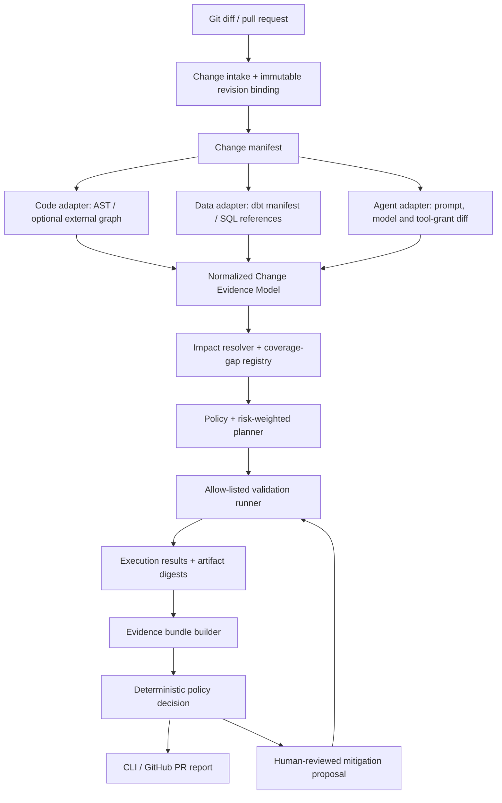

# Cross-Layer Change Assurance (CLCA) — MVP Architecture v0.2

**Date:** 28 October 2026  
**Track:** Developer Productivity  
**Status:** Implementation blueprint; repository name and product branding not yet cleared.

> **Product thesis:** For a proposed change, assemble evidence about what it can affect across code, data contracts, and AI-agent configuration; run an appropriately scoped verification plan; and produce a reproducible release decision—or explicitly state what remains unverified.

## 0. Executive decision

Do not build a new general-purpose code graph. Public projects already cover substantial portions of source-code impact analysis, code/data lineage, risk triage, test selection, and agent security regression testing. Current reference points include [impactgraph](https://github.com/sumit-gupta03/impactgraph), [AxiomCode Graph](https://github.com/AxiomCodeAI/axiomcodegraph), [Enola](https://github.com/enola-labs/enola), [Code System Graph](https://github.com/dertin/code-system-graph), [Farol](https://github.com/winnin/farol), and the [OWASP Agent Security Regression Harness](https://github.com/OWASP/Agent-Security-Regression-Harness).

The differentiating hypothesis is the **verified orchestration layer**: normalize evidence from existing tools, plan checks against a declared policy and budget, execute only allow-listed checks in an appropriate runner, preserve exact results/artifacts, invalidate evidence when inputs change, and never translate missing critical evidence into `PASS`.

This is a hypothesis to validate, not a claim that no other system can combine these features. The hackathon must show an apples-to-apples benchmark and explain the limited scope of that benchmark.

### Name

Use **Cross-Layer Change Assurance (CLCA)** as a working name in architecture and code. Avoid presenting “ImpactGraph” as the product name because multiple public repositories already use it. Candidate marketing names such as ChangeAssure or ReleaseEvidence should undergo repository, domain, and trademark checks before public release.

## 1. MVP scope and hard boundaries

### In scope

1. One Git source: local diff first; GitHub pull request integration second.
2. Three initial asset families: Python/API code, SQL/dbt-like data assets, and AI agent prompts/config/tool permissions.
3. A native Python AST / configuration parser plus `manifest.json` ingestion for dbt-style lineage. An optional SQL parser can add literal table/column references.
4. An adapter interface that can later ingest code impact from AxiomCode/Enola/Code System Graph, data lineage from DataHub/OpenMetadata/OpenLineage, and agent scenarios from the OWASP harness.
5. A deterministic policy engine with `PASS`, `WARN`, `BLOCK`, and `INCOMPLETE`.
6. A risk-weighted planner that classifies checks as mandatory, conditional or optional and respects a verification budget without skipping mandatory checks.
7. Controlled execution of a repository-declared allow-list of validation checks.
8. Version-bound evidence bundle and readable Markdown/JSON report.
9. Fixed benchmark repository with known changes and expected outcomes.
10. Human-approved mitigation suggestions for a very small class of deterministic fixes.

### Out of scope for the hackathon MVP

- Universal parsing for every language, data catalog, agent runtime or cloud.
- A new graph database, RAG system, LLM router, general code assistant or source-control platform.
- Auto-merging, auto-deploying, pushing commits, or changing production permissions.
- Executing arbitrary commands emitted by an LLM or found in a pull request.
- Running production data queries or reading customer data as part of dynamic discovery.
- Claiming a statistical guarantee from a small synthetic benchmark.
- Claiming a true zero-regression risk, complete lineage or universal production safety.
- Unsupervised code patch application.

## 2. End-to-end architecture



### Component responsibilities

| Component | Responsibility | Must not do |
|---|---|---|
| Change intake | Resolve base/head commits, diff digest, repository identity, event source | Accept branch names as the only immutable identity |
| Change manifest | Represent changed paths, symbols, config paths and file digests | Assume every file has been parsed correctly |
| Evidence adapters | Collect normalized nodes, relationships, facts, source metadata and gaps | Hide ambiguity or silently convert heuristic edges into facts |
| Impact resolver | Traverse only policy-approved relationship types and directions; retain paths and provenance | Treat all edges as bidirectional or all graph hops as equally meaningful |
| Coverage-gap registry | Record stale, unsupported, unresolved or missing evidence | Drop unknowns because a visualization looks cleaner |
| Verification planner | Choose mandatory/conditional/optional checks and explain why | Skip mandatory checks to fit a budget |
| Validation runner | Execute only registered commands/scenarios with resource limits | Run arbitrary pull-request text or model-generated shell commands |
| Evidence bundle builder | Bind results to revisions, inputs, policy, adapters and environment | Reuse stale results after a covered input changes |
| Policy engine | Apply deterministic, versioned rules and status precedence | Allow an LLM or risk score to override a hard rule |
| Mitigation service | Propose a patch for supported high-confidence cases and run validation again | Automatically push, merge or deploy a generated patch |
| Report publisher | Publish succinct PR status and artifact links | Expose secrets, full sensitive logs or untrusted HTML |

### Recommended hackathon stack

- **Python 3.12**, Pydantic 2, Typer or argparse.
- **NetworkX** for an in-memory evidence graph; **SQLite** for run and evidence metadata.
- Native `ast` for Python; dbt `manifest.json` first for model dependencies; structured JSON/YAML diffs for agent manifests; optional `sqlglot`/SQLFluff for static SQL references.
- `pytest` for tests; existing repository commands for checks.
- GitHub Actions for an isolated PR runner. Start CLI-first; add a minimal React/Next.js or static HTML report only after the core decision path works.
- JSON evidence artifacts as the stable interface; Markdown for humans.

Do not introduce Neo4j, a vector database, a message broker or a full hosted service in the MVP unless a measured requirement justifies it.

## 3. Unified Change Evidence Model (UCEM)

The graph is an internal representation. The **evidence model** is the stable public contract and is more important than the graph database implementation.

### 3.1 Asset

Every node uses one canonical shape regardless of its source adapter.

| Field | Type / rule | Purpose |
|---|---|---|
| `asset_id` | Stable string; adapter-qualified if no global identity exists | Canonical identifier |
| `kind` | Controlled enum | `code.function`, `code.class`, `api.endpoint`, `data.table`, `data.column`, `data.model`, `business.metric`, `ai.agent`, `ai.prompt`, `ai.model_binding`, `ai.tool`, `ai.policy`, `test.check`, `deployment.config` |
| `name` | String | Human-readable label |
| `repository` | Optional canonical repo identity | Scope and ownership |
| `path` | Optional path / catalog path | Source location |
| `revision` | Commit/config/catalog snapshot identifier | Version binding |
| `criticality` | `critical`, `high`, `medium`, `low`, `unknown` | Check prioritization; never a substitute for hard policy |
| `identity_status` | `stable`, `adapter_scoped`, `provisional` | Indicates identifier reliability |
| `attributes` | Typed, non-secret metadata | Language, owner, sensitivity, tags |

Avoid arbitrary floating-point confidence as the only truth signal. Different tools calibrate “confidence” differently. Prefer categorical evidence support and resolution, optionally retaining a producer confidence for diagnostics only.

### 3.2 Relationship

| Field | Type / rule | Purpose |
|---|---|---|
| `relationship_id` | Stable digest of endpoints, type and provenance | Identity |
| `source_asset_id`, `target_asset_id` | Required references | Directed edge |
| `relation_type` | Controlled enum | `calls`, `imports`, `implements`, `reads_from`, `writes_to`, `transforms_to`, `exposes`, `consumes`, `uses_prompt`, `uses_model`, `grants_tool`, `validated_by`, `deployed_as`, `owns` |
| `impact_direction` | `forward`, `reverse`, `both`, `none` | Explicit propagation rule |
| `resolution` | `resolved`, `inferred`, `ambiguous`, `unresolved` | Interpretation quality |
| `provenance_refs` | One or more EvidenceRecord IDs | Reproducibility |
| `observed_revision` | Exact revision or catalog snapshot | Freshness |
| `limitations` | List | e.g. dynamic SQL or reflection not resolved |

Do not traverse an edge only because its label sounds relevant. Each adapter must declare how each relation can propagate impact.

### 3.3 EvidenceRecord

Required fields: `evidence_id`, `producer_name`, `producer_version`, `evidence_type`, `subject_refs`, `observed_at`, `observed_revision`, `input_digest`, `artifact_digest`, `artifact_ref`, `support` (`direct`, `derived`, `heuristic`, `manual`), `freshness` (`current`, `stale`, `unknown`), and `limitations`.

Artifact references should normally be local or CI artifacts, not public URLs containing secrets or expiring tokens. Logs must be redacted before publishing.

### 3.4 ChangeManifest

Contains `run_id`, repository, immutable `base_revision` and `head_revision`, `diff_digest`, changed paths, changed assets, parser versions, excluded paths and reasons, event origin, and timestamp. Every analysis and decision is bound to this manifest.

### 3.5 ValidationPlan / CheckSpec

Each registered check declares:

- `check_id`, `category`, `asset_kinds`, and `command_ref` or scenario adapter ID.
- `requirement`: `mandatory`, `conditional`, or `optional`.
- trigger policy / selection reason.
- `timeout_seconds`, CPU/memory caps, network policy and approved secret scope.
- estimated duration/cost and actual historical duration/cost where available.
- expected assertions and artifact outputs.
- skip reason when not selected.

`command_ref` resolves to a version-controlled check catalog entry. The plan cannot contain arbitrary shell strings supplied by a model or pull request.

### 3.6 ExecutionResult

Contains `check_id`, status (`passed`, `failed`, `error`, `timed_out`, `not_run`, `skipped_policy`, `unsupported`), exit code, start/end time, duration, runner image digest, environment digest, input digest, redacted summary and artifact digests. A planned but unexecuted check remains visible as `not_run` or `skipped_policy`.

### 3.7 EvidenceBundle

The bundle binds:

- ChangeManifest and diff digest.
- Adapter versions, configuration digests and collection status.
- Assets, relationships, evidence references and coverage gaps.
- Validation plan, exclusions and reasons.
- Execution results and artifact digests.
- Policy version/digest, decision, rule hits and limitations.
- Bundle digest and creation time.

**Invalidate or mark stale** if the head commit, relevant prompts, tool grants, model bindings, schemas, check definitions, adapter version or policy digest changes. A report from a previous commit must not be reused as current evidence. A required check marked `passed` is only accepted as verified if the bundle contains its exit code, duration, input digest, environment digest, and at least one execution artifact/reference. A status string on its own is not proof.

## 4. Decision policy

### Status semantics

- **`BLOCK`**: a known hard-block rule fired: a mandatory check failed, prohibited tool permission was added, a data contract failed, or another explicit policy violation occurred.
- **`INCOMPLETE`**: no known hard-block rule necessarily fired, but required evidence or validation is missing, stale, ambiguous, unsupported or did not execute. The system cannot make the required determination.
- **`WARN`**: all mandatory checks and evidence requirements are satisfied, but a non-blocking issue or expressly permitted limitation remains.
- **`PASS`**: every required check passed, the required dependency evidence is sufficiently fresh/resolved for the defined scope, no blocking or warning rule remains, and the bundle is bound to the exact inputs.

### Precedence

1. `BLOCK` when any known hard-block rule fires.
2. Else `INCOMPLETE` when required evidence/checks are missing, stale, unresolved or not run.
3. Else `WARN` when non-blocking warnings remain.
4. Else `PASS`.

The report must still disclose other gaps if `BLOCK` is primary. This is a scoped policy outcome, not a guarantee of system safety.

### Invariants

1. Missing mandatory evidence never yields `PASS`.
2. A failed mandatory check cannot be averaged away by a numeric score.
3. LLM output cannot choose or downgrade the final status.
4. Risk scores order checks; deterministic policy rules decide hard failures.
5. Unknown dynamic dependencies on critical assets force a configured broader validation fallback or `INCOMPLETE`.
6. Check timeout/error/unsupported is not success. A required `passed` check without execution proof (exit code, duration, input/environment digests and artifact reference) is `INCOMPLETE`.
7. Human waiver requires authorized identity, reason, expiry/review condition and audit log.
8. Evidence only applies to the exact revision, relevant configuration digests, adapter versions and policy version.

## 5. Risk-weighted verification planner and budget

A score is useful for ordering work, not for bypassing safety requirements.

### Inputs

- Impacted asset types and paths.
- Asset criticality and data sensitivity.
- Relationship resolution and evidence freshness.
- Declared test coverage and check-to-asset mapping.
- Check cost/time estimates and hard timeout limits.
- Policy-mandated tests and permission rules.
- Available verification budget (seconds, estimated API cost or runner quota).

### Planning rules

1. **Select mandatory checks first.** They cannot be removed to satisfy a budget.
2. Select conditional checks from changed/impacted asset type and explicit rules: data-column change → schema/data contracts; prompt/model/tool change → agent eval/security checks; code/API change → affected unit/integration/contract checks.
3. Rank optional checks by additional impact coverage per unit cost, using calibrated historical data where available. For MVP, use transparent rule ordering rather than an opaque learned optimizer.
4. If a critical impact path is unresolved, expand to the configured full applicable suite where feasible; otherwise return `INCOMPLETE`.
5. Record every selected and excluded check with a reason.
6. During benchmark mode, run selected checks and the full applicable suite on separate equivalent runs to measure missed failures. Do not assume the selector is safe before validation.
7. A numeric “risk score” never overrides a mandatory policy failure or proves zero regression risk.

### Suggested simple prioritization (not a gate)

`priority = asset_criticality × impact_reach × uncertainty_multiplier × failure_cost_band`

Use ordinal bands, not false precision. Log the inputs and weights. Do not call the resulting number a probability unless calibrated against representative labeled outcomes.

### Budget exhaustion behavior

- Mandatory checks always run or cause `INCOMPLETE` / `BLOCK` as defined by policy.
- If optional budget remains, run optional checks by priority.
- If optional checks are skipped, emit `skipped_policy`, selection reason and estimated work avoided.
- Do not report “0% regression risk.” Report actual benchmark results and the untested scope.

## 6. Data lineage freshness and fallback probing

Lineage should be a multi-source evidence input, not a truth oracle.

### Evidence order

1. dbt `manifest.json` or an authoritative catalog export for declared models/dependencies.
2. Parsed SQL references for literal table/column relationships.
3. Code-level references and configuration manifests.
4. Optional metadata-only probe against a configured, read-only source.
5. If the dependency remains unknown, record a `CoverageGap` and broaden validation or return `INCOMPLETE`.

### Dynamic probe safety

- No arbitrary SQL from a pull request is executed against a live target.
- MVP probe is metadata-only and explicitly allow-listed (e.g. catalog schema inspection or dialect-approved `DESCRIBE` / schema-only prepare), with statement timeout and read-only credentials.
- Do not sample or return row contents. Avoid `SELECT *` as a generic probe; it can still be costly or trigger view/function behavior depending on the platform.
- Probe only known catalog/schema/table identifiers after validation; do not interpolate untrusted identifiers into SQL.
- Record source, principal/permission class (not credentials), timestamp, query template ID, result digest and limitations.
- If the source is unreachable, denied, stale or ambiguous, preserve the gap; never silently treat it as “no dependency.”

For the hackathon demo, a checked-in dbt manifest plus a clearly labeled metadata-probe simulator is sufficient. Real catalog credentials and production integrations are not required.

## 7. AI prompt/config change handling

### Change detection layers

1. Exact file hash and structured diff of the prompt, tool schema, allowed tools, model identifier, system/developer instructions, retrieval source configuration and safety policy.
2. Policy rules for privilege changes, model changes, output-contract changes and tool-argument changes.
3. Optional semantic similarity / embedding drift to prioritize which prompt edits deserve deeper review.
4. Targeted behavior/security evaluations for any change that affects behaviorally relevant fields.

**Embedding similarity is never the sole reason to skip an evaluation.** A small wording change can alter behavior; a large textual rewrite may be behavior-equivalent. Use semantics as a triage feature only, and tie the final plan to policy and empirical checks.

### Flaky / nondeterministic evaluations

- Prefer deterministic assertions: JSON schema, tool allow/deny, required/forbidden event, invariants, exact policy outcomes and bounded numeric values.
- Run baseline and candidate under the same model/runtime/fixture when possible. Pin model IDs and configuration; use temperature 0 when available, but do not claim that it guarantees determinism.
- For behavior tests that can vary, use repeated trials and report counts/rates and uncertainty. An MVP policy can do an initial 3-trial screen, increase to 10 for borderline cases, and report `INCOMPLETE` or `WARN` if the result remains inconclusive. These sample counts are a practical demo policy, not universal statistical sufficiency.
- Treat score thresholds, allowed variance and stopping rules as versioned config.
- If a baseline is already flaky, identify it; don't silently treat a flaky assertion as passed.
- For hackathon reliability, combine a deterministic mock agent/tool with a small optional live-LLM test. Keep live-model results separate from deterministic benchmark claims.

## 8. Mitigation proposals: actionable, not autonomous

### MVP scope

Implement one narrow fix class: an explicit field rename or schema-contract update where the intended mapping is known and the impacted file set is bounded.

Workflow:

1. Find a supported, high-confidence break and identify the source change plus affected consumer.
2. Generate a patch proposal from a deterministic template first; an LLM may explain or draft within a restricted file allow-list.
3. Show a unified diff, exact files/lines, rationale, and assumptions.
4. Developer explicitly previews/applies it to a temporary worktree or draft branch.
5. Run the relevant mandatory checks again against the patched tree.
6. Mark the suggestion `validated` only if those checks actually passed; otherwise show failures and leave the original tree unchanged.
7. No auto-commit, push, merge or deployment in MVP.

A “one-click fix” demo should mean **preview and apply in a temporary branch after user approval**, not unattended repository write access. Every generated patch is untrusted input and must pass the same validation and policy gates as a human-authored patch.

## 9. Tredence-specific demonstration without pretending to have internal access

The product should complement Tredence's public data/AI accelerator direction, not claim to protect or integrate with private systems without authorization.

Recommended demo: a synthetic retail analytics workflow with a Python sales API, dbt sales models, a business metric definition, and a replenishment-agent manifest. Use a generic `data-quality-rules.json` adapter whose interface can later map to an authorized enterprise quality product. If using names such as Sancus or UnityGO in sponsor conversations, label the connector as a **proposed adapter / mock demonstration** unless an approved API or test environment is provided. Do not use Tredence logos, proprietary rules, customer data or internal endpoints without permission.

A credible story: “The same assurance engine can protect changes in the data pipelines and agents that power industry accelerators.” Avoid claiming a real product integration until it is implemented and verified.

## 10. Repository layout

```text
cross-layer-change-assurance/
├── README.md
├── pyproject.toml
├── config/
│   ├── policy.json
│   └── check_catalog.json
├── schemas/
│   ├── evidence-bundle.schema.json
│   └── change-manifest.schema.json
├── src/clca/
│   ├── cli.py
│   ├── models.py
│   ├── intake/
│   │   ├── git_diff.py
│   │   └── manifest.py
│   ├── adapters/
│   │   ├── base.py
│   │   ├── python_ast.py
│   │   ├── dbt_manifest.py
│   │   ├── agent_config.py
│   │   ├── external_code_graph.py
│   │   ├── data_lineage.py
│   │   └── agent_security.py
│   ├── graph/
│   │   ├── normalize.py
│   │   ├── traverse.py
│   │   └── gaps.py
│   ├── planner/
│   │   ├── rules.py
│   │   ├── budget.py
│   │   └── plan.py
│   ├── runner/
│   │   ├── allowlist.py
│   │   ├── subprocess_runner.py
│   │   └── artifacts.py
│   ├── policy/
│   │   └── decide.py
│   ├── fixes/
│   │   ├── propose.py
│   │   └── validate_patch.py
│   └── reporting/
│       ├── markdown.py
│       └── github_comment.py
├── benchmark/
│   ├── manifest.json
│   ├── scenarios/
│   ├── runner.py
│   └── results/
├── sample_app/
│   ├── backend/
│   ├── data/dbt/
│   ├── agents/replenishment/
│   └── tests/
├── .github/workflows/clca.yml
└── tests/
    ├── test_policy.py
    ├── test_planner.py
    ├── test_evidence_invalidation.py
    └── test_scenarios.py
```

Start with `models.py`, `policy/decide.py`, one native adapter, `planner/plan.py`, the safe runner, and the benchmark runner. The web UI comes later.

## 11. CLI and API contract

### CLI-first commands

```bash
clca analyze --repo . --base <base-sha> --head <head-sha> --policy config/policy.json
clca plan --bundle artifacts/change-manifest.json --checks config/check_catalog.json
clca verify --plan artifacts/validation-plan.json --runner local-isolated
clca decide --bundle artifacts/evidence-bundle.json --policy config/policy.json
clca report --bundle artifacts/evidence-bundle.json --format markdown
clca benchmark run --manifest benchmark/manifest.json --mode comparison
```

The first version may combine `analyze`, `plan`, `verify` and `decide` in one command, but keep the internal contracts separate so each step can be inspected and replayed.

### Optional API after CLI works

- `POST /v1/runs` — submit immutable repository/revision references and policy ID.
- `GET /v1/runs/{run_id}` — run state and decision.
- `GET /v1/runs/{run_id}/evidence` — versioned evidence bundle.
- `GET /v1/runs/{run_id}/report` — human-readable report.
- `POST /v1/runs/{run_id}/fix-proposals` — request a supported, non-writing patch proposal.

Never accept an arbitrary remote repository URL and credentials without an explicit trust policy. For the hackathon, local repo/CI-only is safer and sufficient.

## 12. Benchmark harness: first-class deliverable

Build a **48-scenario synthetic monorepo benchmark** alongside the policy engine. The benchmark is not a claim of generalization; it is a controlled regression suite and a fair comparison harness.

### Sample application

```text
sample_app/
├── backend/api/sales.py
├── backend/services/pricing.py
├── data/dbt/manifest.json
├── data/dbt/models/stg_sales.sql
├── data/contracts/sales_contract.json
├── metrics/net_sales.yml
├── agents/replenishment/agent.py
├── agents/replenishment/prompts/system.md
├── agents/replenishment/tool_manifest.json
└── tests/
    ├── unit/
    ├── contract/
    └── agent/
```

### Scenario distribution

| Family | Count | Scenario types |
|---|---:|---|
| Safe / low-impact | 12 | Docs-only, rename local variable, test-only changes, harmless refactor, formatting, nonfunctional config, safe dependency patch, comments, unrelated asset, no-op, generated file refresh, low-risk isolated change |
| Code / API | 12 | Function behavior regression, signature change, API response field rename, validation removal, boundary-value bug, auth guard deletion, consumer break, exception behavior change, route change, missing integration test, unresolved dynamic call, false-positive safe refactor |
| Data / lineage | 12 | Column rename with consumer updated, column rename with contract stale, SQL transformation semantic change, dbt upstream dependency change, metric definition drift, nullability change, stale lineage, missing manifest edge, unauthorized schema probe, dynamic SQL unknown, generated fix proposal, fix fails revalidation |
| Agent / AI / permissions | 12 | Tool-grant escalation, new outbound tool, prompt output-schema regression, repeated-run behavior degradation, model binding change, retrieval source change, prompt cosmetic edit, denied-tool-call regression, missing evaluation artifact, flaky baseline, semantically similar but behavior-changing edit, agent check unavailable |

Each scenario must declare: `scenario_id`, input commit/patch, expected impacted assets, expected mandatory checks, seeded fault (if any), expected allowed statuses, known limitations and scenario-family label. Store scenario expectations outside the analyzer input to avoid leaking test labels into the tool.

### Comparison configurations

A. Existing full applicable test suite (baseline).  
B. Native repo selector (e.g. native test tooling).  
C. Best applicable existing impact/test tool per supported language, selected after running a pilot.  
D. CLCA with static evidence only.  
E. CLCA with integrated data/agent evidence and verification execution.

Not every candidate supports every scenario family. Report per-tool coverage and exclude unsupported cases only from that tool's comparative denominator; also show the overall denominator so scope differences remain visible.

### Metrics

- **Failure-revealing test recall:** selected checks that reveal seeded failures divided by all applicable checks that reveal those failures in the full-suite oracle run.
- **Seeded regression detection:** known seeded regression scenarios caught by the workflow divided by supported seeded scenarios with a valid oracle.
- **False-block rate:** safe scenarios incorrectly blocked divided by safe scenarios.
- **Evidence completeness:** required evidence fields/checks present and version-bound divided by required evidence fields/checks.
- **Decision soundness:** cases with known mandatory failure or missing mandatory evidence that incorrectly report `PASS` (target is zero in the benchmark).
- **Wall-clock time and execution cost:** by scenario family and configuration, including setup overhead.
- **Test count / runtime reduction:** compare to baseline; never report this without the detection and false-block results alongside it.
- **Fix utility:** suggested patches accepted by a reviewer, passing relevant tests after application, and not introducing new seeded failures.

Do not advertise “100% regression detection,” “40% faster,” or “zero risk” until measured. With 48 cases, results are useful engineering evidence but not strong statistical evidence of universal performance. Report raw counts and uncertainty, not only aggregate percentages.

### Minimum acceptance gates for hackathon

1. No known hard policy violation in the seeded suite may return `PASS`.
2. Missing/stale mandatory evidence may never return `PASS`.
3. No check can run outside the declared command allow-list and runner policy.
4. Every decision is reproducible from a retained evidence bundle and policy version.
5. Benchmark reports detection, false blocks, evidence completeness and time/cost together.
6. Any claimed productivity improvement is measured against the same scenario set and baseline.

## 13. Mitigating AI evaluation flakiness

The evaluation should distinguish **hard policy assertions** from **probabilistic quality assertions**.

- Hard assertions: prohibited tool calls, invalid JSON schema, missing required field, disallowed external recipient, unauthorized write, or violated numeric invariant. A single observed hard violation can trigger `BLOCK` under policy.
- Probabilistic assertions: answer relevance, tone, ranking, free-form correctness. Use baseline/candidate repeated runs, same fixtures, and a predeclared scoring threshold; report distributions and uncertainty. Do not convert a small sample into a guarantee.
- Use initial 3-run screening and extend borderline cases up to 10 runs for the MVP. If still inconclusive, return `INCOMPLETE` or `WARN` under explicit policy rather than pretending the model is deterministic.
- Embedding similarity only prioritizes work. It cannot suppress mandatory tests, tool-permission checks or behavior tests required by policy.
- Cache only when the cache key includes the model ID, prompt/config digests, tool schema, relevant retrieval snapshot, evaluator version and fixture version. Cached outputs are not fresh evidence for changed inputs.

## 14. Secure execution model

Assume repository code and pull-request content are untrusted.

- Prefer ephemeral CI runners or short-lived isolated containers/VMs for test execution.
- Do not execute code inside the API process. The orchestrator should issue a constrained job spec to the runner.
- Use a strict command catalog with approved executable + argument patterns. No shell command generated from LLM output.
- Fork PRs receive no production secrets. Use least-privilege read-only tokens and minimal GitHub Actions permissions.
- Disable or restrict outbound network by default; allow only explicitly declared endpoints for checks that require them.
- Enforce time, memory, CPU and output-size limits; redact secrets from logs; retain artifact digests.
- Validate paths to prevent traversal/symlink escape when applying patches or writing artifacts.
- Dynamic lineage probes use an allow-listed read-only metadata principal and must not return rows.
- Patch generation occurs in a temporary worktree; no automatic push, merge or deploy.
- GitHub comments escape untrusted Markdown/HTML and contain summaries rather than raw sensitive logs.

## 15. Benchmark-first delivery plan

### Day 1 — Contract and ground truth

- Freeze the model schemas and status invariants.
- Build the sample app and scenario manifest before implementing all analysis logic.
- Add tests for `BLOCK > INCOMPLETE > WARN > PASS` precedence.
- Implement native Git diff intake and file hashes.

**Exit criterion:** a CLI can load a scenario, create a ChangeManifest, and decision unit tests prove the no-false-PASS invariants.

### Day 2 — Adapters and planner

- Implement Python AST symbol extraction and dbt manifest ingestion.
- Parse agent manifest/prompt/model/tool-grant diffs.
- Normalize evidence and preserve unknown relationships.
- Implement targeted plan, full-suite fallback and declared-budget behavior.

**Exit criterion:** the three asset families can contribute to one plan and every skipped check has a reason.

### Day 3 — Runner, AI eval and evidence bundle

- Implement allow-listed execution with timeout/resource handling.
- Capture exit code, duration, redacted summary and artifact digest.
- Add hard agent policy assertions and repeated-run support for behavior tests.
- Generate the evidence bundle and deterministic decision.

**Exit criterion:** seeded failures cause an evidence-backed `BLOCK`; unavailable mandatory checks cause `INCOMPLETE` rather than `PASS`.

### Day 4 — Mitigation, report and comparison

- Add one patch proposal path for a known column/field rename.
- Re-run mandatory checks after the patch in a temporary worktree.
- Build Markdown/GitHub PR report; add a small visualization only if the CLI/report is stable.
- Run all benchmark configurations and publish raw result JSON/CSV plus limitations.

**Exit criterion:** a judge can see the diff, impact path, actual failing check/log excerpt, proposed fix, rerun result and measured baseline comparison.

## 16. Demo script (4–5 minutes)

1. **Show the baseline:** one harmless change and one deliberately broken change; show what the normal test command runs.
2. **Data contract scenario:** change `user_id` to `customer_id` in the source model; show code/data/metric paths and a real failing contract check.
3. **Agent permission scenario:** add a write tool to the tool manifest; show deterministic policy block even if unit tests pass.
4. **Prompt regression scenario:** run the behavior suite repeatedly; show a measured degradation or an explicit inconclusive outcome.
5. **Mitigation proposal:** produce a limited unified diff for the data consumer, preview it, apply in a temporary worktree, and rerun checks.
6. **Safe change:** show the planner selecting a smaller suite, the reason for omitted optional checks, measured runtime comparison, and no claim that risk is zero.
7. **Close:** display the evidence bundle tied to the exact commit/policy/config digest.

## 17. Differentiation statement for judges

> Existing tools can map code impact, find cross-repository contracts, rank PR risk, select tests, or execute agent-security scenarios. CLCA's proposed contribution is the normalized evidence contract and the policy-driven orchestration that connects these sources to a controlled verification plan, captures actual check execution, invalidates stale evidence, exposes unresolved gaps, and benchmarks the safety/productivity trade-off. Its value must be demonstrated against existing tools on the same supported scenarios—not asserted from the architecture alone.

## 18. Key risks and mitigations

| Risk | Mitigation |
|---|---|
| Adapter integrations consume the hackathon | Native adapters and fixture files first; only one external adapter after a comparison pilot |
| Graph misses dynamic behavior | Preserve unresolved edges; fallback to broader suite or `INCOMPLETE` |
| Stale lineage creates false confidence | Freshness metadata and optional read-only metadata probe; never interpret missing edge as no dependency |
| LLM evals are flaky | Hard deterministic assertions plus repeated trials for probabilistic checks; inconclusive status is first-class |
| Test budget skips critical coverage | Mandatory checks are non-skippable; risk prioritizes optional checks only |
| Auto-fix makes code worse | Patch preview, temporary worktree, full relevant revalidation, human approval |
| Product looks generic to Tredence judges | Synthetic retail/data/agent demo; propose authorized accelerator adapter, do not claim private integration |
| Benchmark is too small | Publish raw scenario outcomes and scope; call it a controlled engineering benchmark, not proof of universal effectiveness |

## 19. Public reference points reviewed

- [ImpactGraph — code/data pre-merge blast radius](https://github.com/sumit-gupta03/impactgraph). As of the live repository page checked on 28 October 2026, it advertises a risk-level CI gate, Markdown PR comment, JSON/HTML outputs and a recommended test plan; the page displays an MIT license. Do not confuse its risk-based exit code with proof that each recommended test was executed; verify current implementation before making that comparison.
- [AxiomCode Graph — compiler-grounded code impact/test selection](https://github.com/AxiomCodeAI/axiomcodegraph)
- [Enola — multi-repository architecture graph](https://github.com/enola-labs/enola)
- [Code System Graph — cross-repository evidence graph](https://github.com/dertin/code-system-graph)
- [Farol — PR risk prioritization](https://github.com/winnin/farol)
- [OWASP Agent Security Regression Harness](https://github.com/OWASP/Agent-Security-Regression-Harness)
- [DataHub impact analysis](https://docs.datahub.com/docs/act-on-metadata/impact-analysis)
- [OpenLineage](https://github.com/OpenLineage/OpenLineage)
- [dbt manifest artifact reference](https://docs.getdbt.com/reference/artifacts/manifest-json)
- [GitHub Actions security hardening](https://docs.github.com/en/actions/security-for-github-actions/security-guides/security-hardening-for-github-actions)

Repository features and statuses change quickly. Recheck current README, license, supported language matrix and releases before choosing an implementation dependency. For example, AxiomCode's current README publishes a benchmark and a license notice that should be reviewed for the intended use; a repository's public source is not automatically unrestricted for incorporation. The OWASP Agent Security Regression Harness currently describes itself as an executable regression harness, not a benchmark, and lists benchmark scoring among its unimplemented items in its README. The architecture intentionally does not assume that a named adapter is already integrated or licensed for redistribution.
